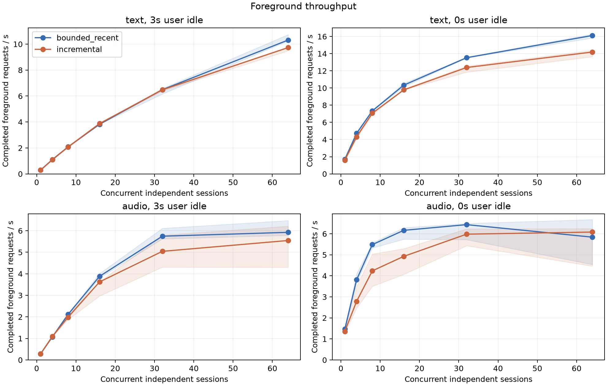
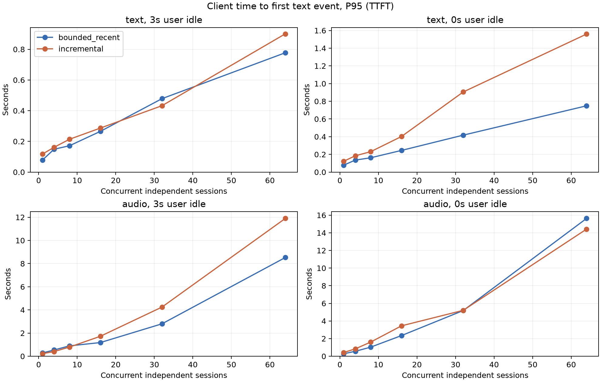
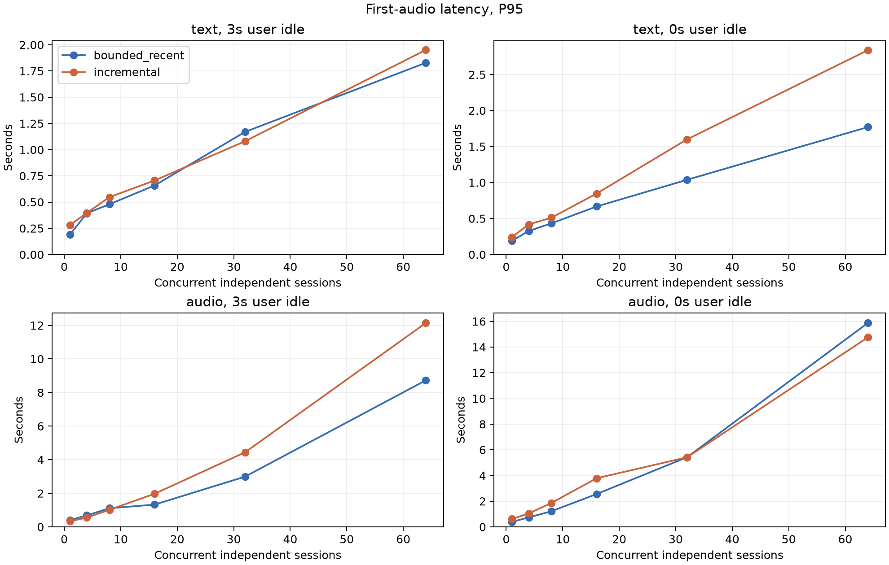

# Concurrent serving performance — November 12, 2026 (UTC+8)

**Result:** on this workload, incremental history does not show a general foreground-throughput gain over same-limit clipping. With zero user idle, text RPS is 8.4% lower at 32 sessions and 11.9% lower at 64 sessions, with higher TTFT/TTFP. Audio at 64 sessions has substantial repeat-to-repeat variation and overlapping RPS ranges. These are same-head policy comparisons; quality acceptance remains separate.

**Environment and workload.** Clean PR head `3f251512a9e0c88a2e6706494ddbb22cdebd4d45`; Qwen3-Omni-30B-A3B-Instruct revision `26291f793822fb6be9555850f06dfe95f2d7e695`. The separate HKH200 host reports **2 × NVIDIA L20X, 143,771 MiB per GPU**, driver 570.133.20. Python 3.12.13, vLLM 0.33.0, Torch **2.14.0+cu130**, Triton 3.8.0, Transformers 5.19.0. Both policies use the same two GPUs, inputs and deployment settings. This host/environment differs from the earlier sequential quality experiment documented in [PR #9960](https://github.com/vllm-project/vllm-omni/pull/9960).

Completed **144/144 formal cohorts, 0 failed cohorts**, covering 1/4/8/16/32/64 independent sessions, text and original synthetic Mandarin audio, 0 s/3 s user idle, and three repetitions. This is 3,000 sessions, 72,000 foreground turns including buildup, and **48,000 measured foreground requests**. Plots include all six concurrency levels; the tables below retain 1, 32 and 64.

**Measurement.** Each closed-loop session waits for a complete response before its next turn; generated audio is acknowledged immediately, without real-time playback pacing. Eight live buildup turns precede a shared barrier and 16 measured turns, with 20 ms lane staggering. Foreground RPS excludes auxiliary requests, and its denominator includes configured user idle and staggering. RPS is the **median of three independent repeats**, with the min–max range shown in brackets and plot shading. TTFT/TTFP P95 pools valid measured-turn samples across the three repeats; it is not the median of the per-repeat P95 values. TTFT is the client-observed first output text/transcript-delta event; TTFP is the first audio-delta event. Text timing begins immediately before response creation after sending the user text; audio timing begins before commit and excludes the preceding PCM upload.

Valid latency samples: **47791/48,000 TTFT** and **47785/48,000 TTFP**. Missing events are omitted rather than treated as zero; per-group counts and P50/P95/P99 are in the linked machine-readable results.

[Machine-readable pooled results](results.json) · [Per-repeat measurements](cohorts.csv)

#### Scaling curves

#### text input, 3 s between complete responses

| Sessions | Policy | Foreground RPS: median [min–max] | TTFT P95, ms | TTFP P95, ms |
| ---: | --- | ---: | ---: | ---: |
| 1 | `bounded_recent` | 0.295 [0.294–0.295] | 78.7 | 190.1 |
| 1 | `incremental` | 0.288 [0.278–0.291] | 117.5 | 280.7 |
| 32 | `bounded_recent` | 6.488 [6.159–6.578] | 478.4 | 1169.4 |
| 32 | `incremental` | 6.477 [6.390–6.568] | 432.5 | 1080.1 |
| 64 | `bounded_recent` | 10.310 [10.238–10.734] | 777.6 | 1828.2 |
| 64 | `incremental` | 9.731 [9.484–9.761] | 900.9 | 1951.1 |

#### text input, 0 s between complete responses

| Sessions | Policy | Foreground RPS: median [min–max] | TTFT P95, ms | TTFP P95, ms |
| ---: | --- | ---: | ---: | ---: |
| 1 | `bounded_recent` | 1.697 [1.675–1.708] | 78.4 | 188.8 |
| 1 | `incremental` | 1.606 [1.510–1.625] | 122.4 | 242.6 |
| 32 | `bounded_recent` | 13.529 [13.511–13.587] | 417.4 | 1037.8 |
| 32 | `incremental` | 12.388 [11.842–12.547] | 905.3 | 1599.8 |
| 64 | `bounded_recent` | 16.112 [15.817–16.273] | 748.8 | 1770.1 |
| 64 | `incremental` | 14.190 [13.641–14.394] | 1559.7 | 2838.2 |

#### audio input, 3 s between complete responses

| Sessions | Policy | Foreground RPS: median [min–max] | TTFT P95, ms | TTFP P95, ms |
| ---: | --- | ---: | ---: | ---: |
| 1 | `bounded_recent` | 0.285 [0.283–0.289] | 284.5 | 395.2 |
| 1 | `incremental` | 0.282 [0.279–0.294] | 220.4 | 334.0 |
| 32 | `bounded_recent` | 5.745 [5.620–6.112] | 2799.1 | 2990.4 |
| 32 | `incremental` | 5.042 [4.309–5.794] | 4245.3 | 4439.6 |
| 64 | `bounded_recent` | 5.924 [5.784–6.472] | 8525.2 | 8727.0 |
| 64 | `incremental` | 5.545 [4.301–6.211] | 11900.4 | 12142.5 |

#### audio input, 0 s between complete responses

| Sessions | Policy | Foreground RPS: median [min–max] | TTFT P95, ms | TTFP P95, ms |
| ---: | --- | ---: | ---: | ---: |
| 1 | `bounded_recent` | 1.466 [1.375–1.505] | 278.7 | 384.0 |
| 1 | `incremental` | 1.359 [1.266–1.425] | 425.5 | 612.8 |
| 32 | `bounded_recent` | 6.434 [5.720–6.493] | 5184.3 | 5422.4 |
| 32 | `incremental` | 5.982 [5.430–6.234] | 5204.2 | 5415.4 |
| 64 | `bounded_recent` | 5.840 [4.538–6.676] | 15634.4 | 15871.1 |
| 64 | `incremental` | 6.082 [4.461–6.247] | 14421.5 | 14749.8 |

Matched settings, token accounting and limitations

- Both policies run on the exact PR head. This is a comparison of `bounded_recent` and `incremental` at matched limits. The default `recent` policy is outside this experiment.
- History context: 2,048 tokens including 128 foreground output tokens; summary output cap 512; recent/chunk targets 8/8; retained audio 64 items / 32 MiB, 8 MiB compression trigger. Stages 0/1 have `max_model_len=8192`; each stage has `max_num_seqs=64`, and `duplex_session.max_sessions=64`. Stage 0 occupies the first GPU; Talker/Code2Wav share the second.
- Policy blocks alternate over repetitions: clipping/summary, summary/clipping, clipping/summary. Cohort order is reversed for the middle repetition. The 64-session extension follows the predeclared rule (any clean first-repeat c32/c16 RPS ratio ≥ 1.10); its first repetition is backfilled at the end.
- Client WebSocket Ping interval/timeout: 20 s/180 s; connection timeout 30 s; foreground timeout 180 s. A fresh complete matrix uses these settings for both arms. The earlier default-20-second-Ping-timeout attempt is excluded. This does not establish default-client stability at these concurrency levels.
- For zero-idle text at c32, three repetitions recorded 2,733,418 foreground input / 25,757 output tokens for clipping, versus 2,765,764 / 25,449 for incremental. Incremental additionally admitted **1,985,975 background input tokens** and emitted **6,153 observed background output tokens** within the measured windows; clipping submits no auxiliary summaries. In this workload, auxiliary inference is added without a foreground-input-token reduction. These counters do not measure pure GPU kernel time, and interval-boundary/in-flight work is only included when observed.
- The host is shared, the client is closed-loop, and audio is synthetic Mandarin without independent listening validation. Audio c64 has broad repeat ranges. The buildup barrier permits extra background catch-up. Foreground output lengths can differ; this experiment does not isolate an output-length-normalized scheduler speedup.
- No images are included. Final-answer strict scores and `needs_review` cases were retained but have not received complete semantic adjudication for this concurrency run; the known visual-memory and persistent-instruction quality gaps remain open.
- Original functions were observed through external wrappers called once with unchanged inputs/results; observer overhead was not separately isolated.
- Frozen input-manifest SHA256: `85d102fc6cffc85b47de641ef4fd4c02aa2e650ca6d5955b34a67b8be051d03c`. Public result artifacts retain per-repeat measurements, pooled percentiles and observed token counters.

