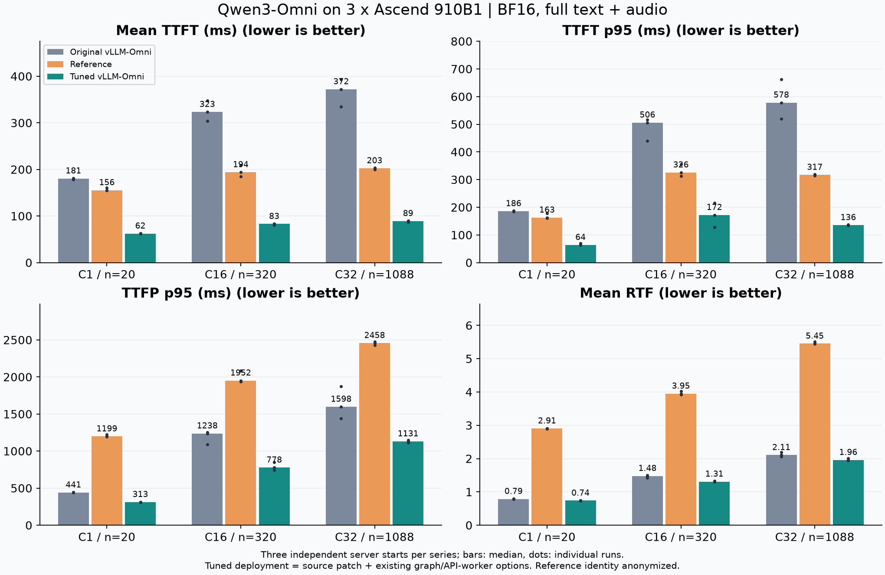

# Qwen3-Omni Ascend TTFT results

This branch publishes only the anonymized figure and aggregate numerical results.
It contains no benchmark datasets, request records, deployment files or scripts.

- Hardware: three Ascend 910B1 cards, BF16, nonduplex full text and audio output.
- Model: Qwen/Qwen3-Omni-30B-A3B-Instruct; Thinker TP2, Talker+Code2Wav on the third card.
- Input: SeedTTS English, identical ordered20/320/1088 samples at C1/C16/C32.
- Three independent formal server starts per series. Bars are medians of per-run metrics; dots are individual runs. Raw per-run aggregates are in metrics.json.
- A fresh cache salt is shared within each measured phase, allowing intra-phase prefix reuse. All series used the same client and inputs.
- Candidate:32 full-audio warmups,64 requests at1RPS,32-request simultaneous burst,64 at4.2RPS, then C1/C16/C32.
- Original formal baseline:3 readiness requests, then max(2,C) warmups before each concurrency. Matched-load reference has two trials; optimized has three independent restarts.
- Measured source: Omni e5f80c9480f6f1765825052a88cdc9717ffe8f78 plus patch b81fc77a7bd8eefd831de55a4b777768009c8df7be05a7b9c5cfc9b376acdaad. The submitted implementation patch is identical after rebase.
- Stack: Python3.12.13,torch2.10.0+cpu,torch_npu2.10.0.post7,CANN9.2.1; vLLM62d4bc3c,Ascend19c063b5.
- Tuning-inclusive result: source patch plus existing prefill/full-decode graph options and two shared-backend API workers; patch-only speedup was not isolated. Async chunk/prefix caching remain enabled, stage sequence limits64; no new quantization or output truncation.
- Quality:3264 outputs; WER3.20-3.34%,SIM0.8223-0.8226. Paired descriptive intervals include zero; statistical equivalence is not established. One terminal-period text difference occurs in each run. quality-aggregate.json contains no per-sample records.
- Current submission CPU tests:357 passed,1 skipped,9 pre-existing Chatterbox V1 fixture cases deselected. Applicable Ruff,mypy3.10,markdownlint and static checks pass. CUDA/ROCm model tests, peak device-memory profiling and full NPU matrix after rebase were not run.

The full local harness and raw datasets are not published. The measurements are
archived results at the pinned source, not a claim of new-head reruns.
